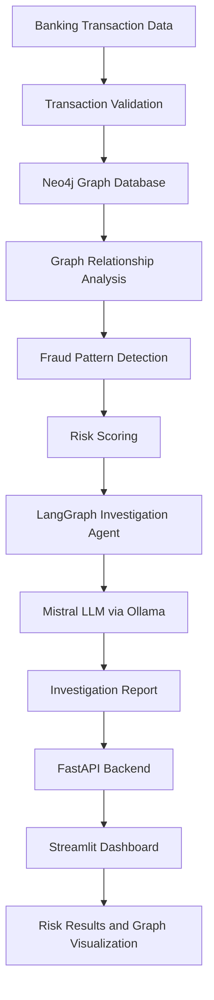

# 🏦 Agentic AI Banking Fraud Detection System

An AI-powered, graph-based banking fraud investigation system that analyzes financial transactions, identifies suspicious patterns, evaluates transaction risk, and generates AI-assisted investigation reports.

**Built with:** Python · LangGraph · Neo4j · Mistral · Ollama · FastAPI · Streamlit

[GitHub Repository](https://github.com/paragg11/agentic-ai-banking-fraud-detection)

---

## 📌 Project Overview

Traditional fraud detection systems often rely on isolated transaction rules. This project explores an agentic AI approach that combines transaction analytics, graph-based relationship detection, risk scoring, and LLM-powered investigation.

The system investigates banking transactions using synthetic transaction data and identifies potentially suspicious activities through transaction patterns and relationships.

It combines deterministic fraud detection with AI-assisted investigation to provide a structured view of suspicious transactions.

## 🎯 Key Features

- **Transaction Investigation:** Investigate transactions using a transaction ID.
- **Graph-Based Fraud Detection:** Analyze relationships between customers, accounts, devices, IP addresses, and transactions using Neo4j.
- **Fraud Pattern Detection:** Identify suspicious transaction behavior and relationship patterns.
- **Risk Scoring:** Calculate transaction risk scores and assign risk levels.
- **Agentic AI Workflow:** Coordinate investigation steps using LangGraph.
- **LLM-Powered Analysis:** Use Mistral through Ollama to generate investigation insights.
- **REST API:** Expose investigation functionality through FastAPI.
- **Interactive Dashboard:** Explore investigation results through Streamlit.
- **Investigation History:** Maintain investigation history during the dashboard session.
- **Fraud Network Visualization:** Visualize relevant fraud relationships through the dashboard.

## 🏗️ System Architecture



See [Architecture Documentation](docs/ARCHITECTURE.md) for the detailed workflow.

## 🛠️ Technology Stack

| Technology | Purpose |
|---|---|
| Python | Core programming language |
| LangGraph | Agent workflow orchestration |
| Neo4j | Graph database and relationship analysis |
| Cypher | Graph database querying |
| Mistral | Large Language Model |
| Ollama | Local LLM execution |
| FastAPI | Backend REST API |
| Streamlit | Interactive frontend |
| Pandas | Transaction data processing |
| Requests | Frontend-to-backend communication |

## 📂 Project Structure

```text
banking-fraud-detection-agent/
│
├── frontend/
│   └── app.py
│
├── src/
│   ├── agents/
│   │   └── fraud_investigation_agent.py
│   │
│   ├── api/
│   │   └── main.py
│   │
│   ├── graph_db/
│   │   ├── graph_loader.py
│   │   ├── graph_schema.py
│   │   └── neo4j_connection.py
│   │
│   ├── graph_detection/
│   │   ├── fraud_patterns.py
│   │   └── transaction_analytics.py
│   │
│   ├── graphrag/
│   │
│   ├── ingestion/
│   │   └── generate_transactions.py
│   │
│   ├── preprocessing/
│   │   └── validate_transactions.py
│   │
│   └── risk_engine/
│       └── risk_scoring.py
│
├── docs/
│   └── ARCHITECTURE.md
│
├── .env.example
├── .gitignore
├── README.md
└── requirements.txt
```

*The structure above highlights the main project modules. Additional files may exist in the repository.*

## ⚙️ System Requirements

- Python 3.10+
- Neo4j Database
- Ollama
- Mistral model downloaded through Ollama
- Git
- Required Python dependencies

## 🚀 Installation and Setup

### 1. Clone the repository

```bash
git clone https://github.com/paragg11/agentic-ai-banking-fraud-detection.git

cd banking-fraud-detection-agent
```

### 2. Create a virtual environment

```bash
python3 -m venv .venv

source .venv/bin/activate
```

### 3. Install dependencies

```bash
pip install -r requirements.txt
```

Ensure `requirements.txt` contains all dependencies imported by the backend, frontend, graph database, and agent modules.

### 4. Configure environment variables

Create your local `.env` file using the project's environment configuration.

Configure the required Neo4j connection credentials and Ollama settings according to the application code.

Do not commit real credentials or API secrets.

### 5. Start Neo4j

Start your Neo4j database and verify that the configured database is accessible.

### 6. Start Ollama

```bash
ollama serve
```

Pull the configured Mistral model if it is not already available:

```bash
ollama pull mistral:latest
```

### 7. Start FastAPI

```bash
uvicorn src.api.main:app --reload --host 0.0.0.0 --port 8000
```

Backend URL:

http://127.0.0.1:8000

Swagger API documentation:

http://127.0.0.1:8000/docs

### 8. Start Streamlit

Open another terminal:

```bash
source .venv/bin/activate

streamlit run frontend/app.py
```

Open the local Streamlit URL displayed in your terminal.

## 🔌 API Documentation

### Health Check

**Endpoint:** `GET /health`

Checks whether the backend is responding.

### Transaction Investigation

**Endpoint:** `POST /investigate`

Investigates a transaction using its transaction ID.

Example request:

```json
{
  "transaction_id": "TXN001502"
}
```

The API returns an investigation response containing the available transaction investigation information, including risk assessment and analysis.

For the exact response schema, refer to:

http://127.0.0.1:8000/docs

## 🔍 Fraud Investigation Workflow

1. Transaction data is generated or loaded.
2. Transaction records are validated.
3. Transaction relationships are stored in Neo4j.
4. Graph analysis examines connected entities and suspicious relationships.
5. Fraud detection logic evaluates relevant patterns.
6. The risk engine calculates the risk score and risk level.
7. LangGraph orchestrates the investigation workflow.
8. Mistral generates AI-assisted investigation insights.
9. FastAPI exposes the investigation results.
10. Streamlit displays the investigation report and visualizations.

## 🧪 Testing and Validation

The project has undergone manual validation of three transaction investigation scenarios.

Verified components include:

- Backend health endpoint.
- FastAPI Swagger documentation.
- OpenAPI specification.
- Transaction investigation API.
- Streamlit-to-FastAPI integration.
- Investigation result rendering.

Automated test coverage is not yet established. Manual validation should not be interpreted as comprehensive production testing.

## 🔐 Data and Security

- Uses synthetic banking transaction data for project demonstration.
- Keeps local environment credentials outside version control.
- Uses deterministic risk scoring alongside LLM-generated insights.
- AI-generated investigation findings should be reviewed and validated before any real-world financial decision.

## 🚧 Current Limitations and Future Enhancements

- Automated unit and integration test coverage.
- Improved AI investigation output consistency.
- Advanced graph analytics and fraud ring detection.
- Persistent investigation history.
- Alerting and notification mechanisms.
- Docker-based deployment.
- Production monitoring and security hardening.

## 👨‍💻 Author

**Parag Gunjal**

GitHub: [@paragg11](https://github.com/paragg11)

LinkedIn: [Parag Gunjal](https://www.linkedin.com/in/parag-gunjal-b16840152/)

---

## ⭐ Project Objective

Demonstrate how graph databases, agentic AI workflows, deterministic fraud analytics, and large language models can work together to support explainable banking fraud investigations.

