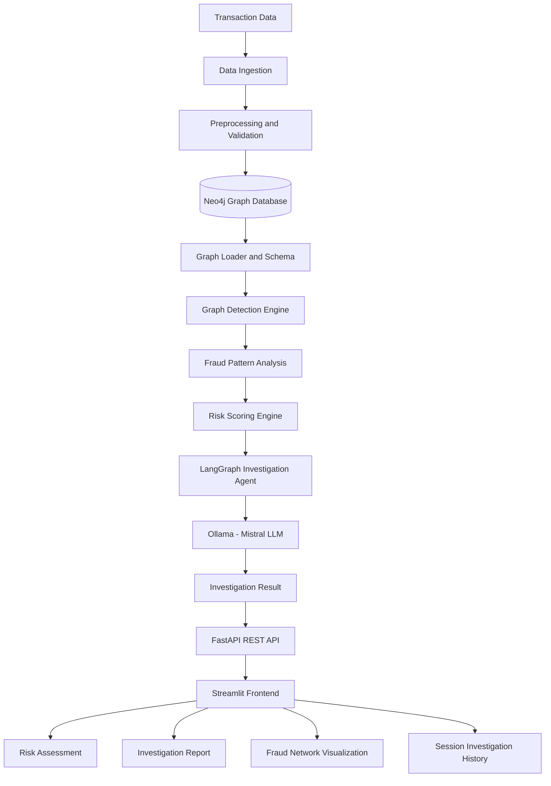
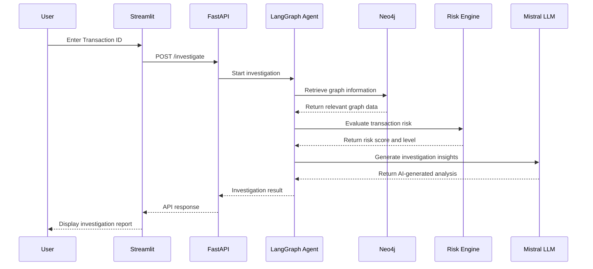

# System Architecture — Agentic AI Banking Fraud Detection

## 1. Introduction

The Banking Fraud Detection Agent is a graph-based fraud investigation application that combines transaction analytics, Neo4j relationship analysis, deterministic risk scoring, and LLM-powered investigation.

The system is designed to investigate suspicious banking transactions and provide structured risk assessments with supporting investigation insights.

## 2. High-Level Architecture

## 3. Architecture Components

### 3.1 Data Ingestion

**Module:** `src/ingestion/`

Responsible for generating or preparing synthetic banking transaction records for investigation.

The transaction data provides the input for the downstream validation and analysis pipeline.

### 3.2 Preprocessing and Validation

**Module:** `src/preprocessing/`

Validates transaction records before they are used in the investigation workflow.

This helps ensure that transaction information is suitable for downstream processing.

### 3.3 Graph Database

**Module:** `src/graph_db/`

**Technology:** Neo4j

Neo4j is used to represent banking entities and their relationships as a graph.

The graph database supports relationship-based investigation, allowing the system to examine connections that may not be obvious when transactions are analyzed individually.

The graph database modules include:

- `graph_loader.py`
- `graph_schema.py`
- `neo4j_connection.py`

### 3.4 Graph-Based Fraud Detection

**Module:** `src/graph_detection/`

This component analyzes transaction patterns and graph relationships.

Its purpose is to identify potentially suspicious behavior and provide relevant information to the risk assessment and investigation workflow.

Main modules:

- `fraud_patterns.py`
- `transaction_analytics.py`

### 3.5 Risk Scoring Engine

**Module:** `src/risk_engine/`

The risk engine evaluates transaction risk using deterministic scoring logic.

It produces a numerical risk score and corresponding risk classification.

This separates measurable risk evaluation from the narrative analysis generated by the LLM.

### 3.6 Agentic AI Investigation

**Module:** `src/agents/fraud_investigation_agent.py`

**Technology:** LangGraph

The investigation agent coordinates the fraud investigation workflow.

It brings together the available transaction information, graph analysis, fraud detection results, and risk assessment.

The LLM is used for AI-assisted investigation insights and report generation.

### 3.7 Large Language Model

**Technology:** Mistral through Ollama

Mistral provides language-model capabilities for interpreting investigation information and generating human-readable insights.

Ollama provides the local model execution environment.

The LLM output is an investigation aid, not an independently verified fraud determination.

### 3.8 Backend API

**Module:** `src/api/main.py`

**Technology:** FastAPI

The backend exposes the investigation functionality through REST endpoints.

Available verified endpoints:

| Method | Endpoint | Purpose |
|---|---|---|
| GET | `/` | API availability |
| GET | `/health` | Health check |
| POST | `/investigate` | Transaction investigation |

Interactive API documentation is available through FastAPI Swagger UI at `/docs`.

### 3.9 Frontend Dashboard

**Module:** `frontend/app.py`

**Technology:** Streamlit

The frontend provides an interactive interface for investigating transactions and viewing results.

Dashboard capabilities include:

- Transaction investigation input.
- Risk assessment display.
- Investigation report presentation.
- Fraud graph visualization.
- Session-based investigation history.
- Error handling for backend connectivity and API failures.

## 4. Investigation Data Flow

The investigation follows this logical sequence:

*This sequence represents the intended logical interaction between the implemented components; exact node execution order should be confirmed against the LangGraph implementation.*

## 5. Technology Architecture

| Layer | Technology |
|---|---|
| Programming | Python |
| Agent orchestration | LangGraph |
| Graph database | Neo4j |
| Graph query language | Cypher |
| LLM | Mistral |
| Local model runtime | Ollama |
| Backend | FastAPI |
| Frontend | Streamlit |
| Data processing | Pandas |
| HTTP communication | Requests |

## 6. Design Principles

### Separation of Responsibilities

Transaction validation, graph analysis, risk scoring, AI reasoning, API handling, and presentation are maintained in separate modules.

### Deterministic Risk Assessment

Numerical risk assessment is handled by dedicated scoring logic rather than relying entirely on probabilistic LLM output.

### Relationship-Based Analysis

Neo4j enables investigation of connected entities and transaction relationships.

### AI-Assisted Investigation

The LLM adds natural-language interpretation to the investigation process.

### Modular Architecture

Individual components can be improved or extended without requiring the entire application to be redesigned.

## 7. Current Validation

The following application-level checks have been manually performed:

- FastAPI root endpoint responds successfully.
- Health endpoint responds successfully.
- Swagger documentation loads.
- OpenAPI specification is accessible.
- Transaction investigation API works.
- Streamlit frontend communicates with FastAPI.
- Three transaction investigation scenarios have been tested.

Automated regression testing and production-scale validation remain future work.

## 8. Future Architecture Enhancements

1. Automated unit and integration tests.
2. Improved investigation evidence consistency.
3. Advanced graph-based fraud ring detection.
4. Persistent investigation history.
5. Real-time suspicious transaction alerts.
6. Docker containerization.
7. Cloud deployment and monitoring.
8. Authentication, authorization, and audit logging.

## 9. Conclusion

This project demonstrates an approach to banking fraud investigation that combines graph databases, agentic workflows, deterministic risk scoring, and large language models.

The modular design provides a foundation for extending the system with additional fraud patterns, investigation capabilities, automated testing, and production-oriented infrastructure.